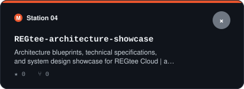
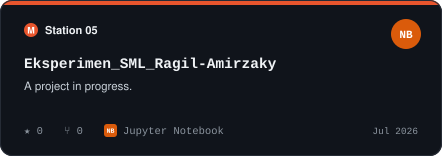
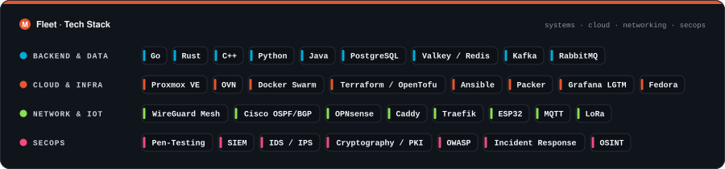
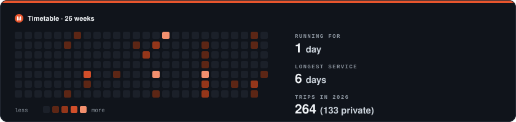
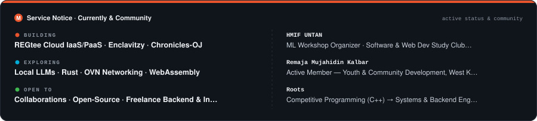

<!--
  ╔═══════════════════════════════════════════════════════════════════╗
  ║  COMMIT METRO — every line is a language, every stop a project    ║
  ║  Semua SVG di /metro (dark & light) di-generate otomatis oleh     ║
  ║  .github/workflows/commit-metro.yml (public + private + orgs).    ║
  ║  Jangan edit blok STATIONS manual — akan ditimpa generator.       ║
  ╚═══════════════════════════════════════════════════════════════════╝
-->

  <a href="https://github.com/Lapnes">
    <picture>
      <source media="(prefers-color-scheme: light)" srcset="metro/light/map.svg"/>
      <source media="(prefers-color-scheme: dark)" srcset="metro/map.svg"/>
      
    </picture>
  </a>

Every line is a language I write; every stop is one of my projects.

<a href="https://github.com/Lapnes">
  <picture>
    <source media="(prefers-color-scheme: light)" srcset="metro/light/interchange.svg"/>
    <source media="(prefers-color-scheme: dark)" srcset="metro/interchange.svg"/>
    
  </picture>
</a>

<!-- STATIONS:START -->

  <picture><source media="(prefers-color-scheme: light)" srcset="metro/light/station-1.svg"/><source media="(prefers-color-scheme: dark)" srcset="metro/station-1.svg"/></picture>
  <picture><source media="(prefers-color-scheme: light)" srcset="metro/light/station-2.svg"/><source media="(prefers-color-scheme: dark)" srcset="metro/station-2.svg"/></picture>

  <a href="https://github.com/Lapnes/luco-untan-dev"><picture><source media="(prefers-color-scheme: light)" srcset="metro/light/station-3.svg"/><source media="(prefers-color-scheme: dark)" srcset="metro/station-3.svg"/></picture></a>
  <a href="https://github.com/Lapnes/SMSML_Ragil-Amirzaky"><picture><source media="(prefers-color-scheme: light)" srcset="metro/light/station-4.svg"/><source media="(prefers-color-scheme: dark)" srcset="metro/station-4.svg"/></picture></a>

  <a href="https://github.com/Lapnes/REGtee-HyTerra"><picture><source media="(prefers-color-scheme: light)" srcset="metro/light/station-5.svg"/><source media="(prefers-color-scheme: dark)" srcset="metro/station-5.svg"/></picture></a>
  <a href="https://github.com/Lapnes/fedora-backup-tools"><picture><source media="(prefers-color-scheme: light)" srcset="metro/light/station-6.svg"/><source media="(prefers-color-scheme: dark)" srcset="metro/station-6.svg"/></picture></a>

<!-- STATIONS:END -->

<picture>
  <source media="(prefers-color-scheme: light)" srcset="metro/light/lines.svg"/>
  <source media="(prefers-color-scheme: dark)" srcset="metro/lines.svg"/>
  
</picture>

<picture>
  <source media="(prefers-color-scheme: light)" srcset="metro/light/fleet.svg"/>
  <source media="(prefers-color-scheme: dark)" srcset="metro/fleet.svg"/>
  
</picture>

<picture>
  <source media="(prefers-color-scheme: light)" srcset="metro/light/timetable.svg"/>
  <source media="(prefers-color-scheme: dark)" srcset="metro/timetable.svg"/>
  
</picture>

<picture>
  <source media="(prefers-color-scheme: light)" srcset="metro/light/dispatch.svg"/>
  <source media="(prefers-color-scheme: dark)" srcset="metro/dispatch.svg"/>
  
</picture>

  <a href="https://github.com/Lapnes">GitHub</a> ·
  <a href="https://porto.tenzly.codes">Website</a> ·
  <a href="https://hub.docker.com/u/tenzly">Docker Hub</a> ·
  <a href="https://linkedin.com/in/ragil-amirzaky">LinkedIn</a> ·
  <a href="https://beacons.ai/lapness21">Beacons</a>

Commit Metro · every line is a language, every stop a project ·
