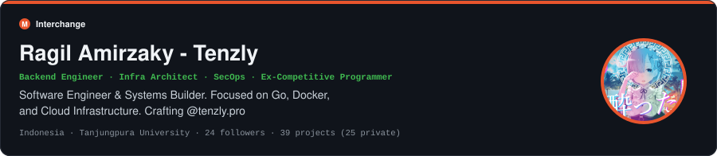
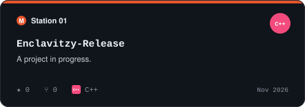
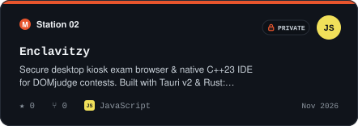
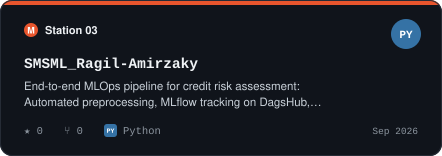
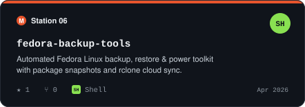

<!--
  ╔═══════════════════════════════════════════════════════════════════╗
  ║  COMMIT METRO — every line is a language, every stop a project    ║
  ║  Semua SVG di /metro di-generate otomatis oleh                    ║
  ║  .github/workflows/commit-metro.yml (public + private + orgs).    ║
  ║  Jangan edit blok STATIONS manual — akan ditimpa generator.       ║
  ╚═══════════════════════════════════════════════════════════════════╝
-->

  

Every line is a language I write; every stop is one of my projects.

<!-- STATIONS:START -->

  
  

  
  

  
  

<!-- STATIONS:END -->

  <a href="https://github.com/Lapnes">GitHub</a> ·
  <a href="https://porto.tenzly.codes">Website</a> ·
  <a href="https://hub.docker.com/u/tenzly">Docker Hub</a> ·
  <a href="https://linkedin.com/in/ragil-amirzaky">LinkedIn</a>

Commit Metro · every line is a language, every stop a project · auto-synced from public, private &amp; org activity
